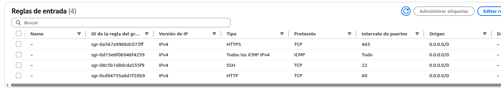
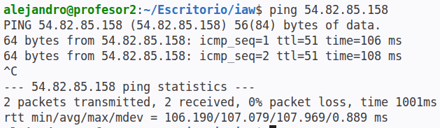
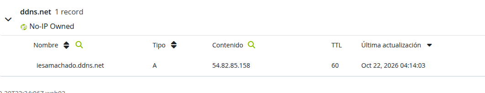
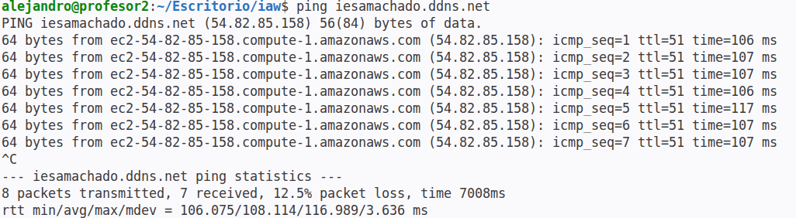
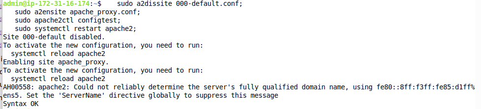
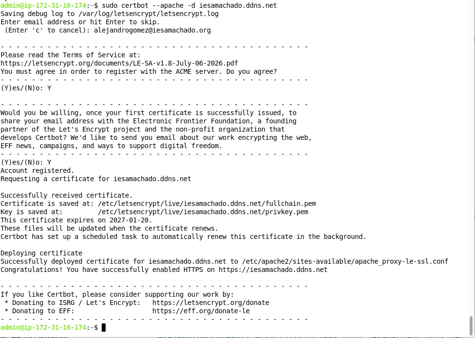
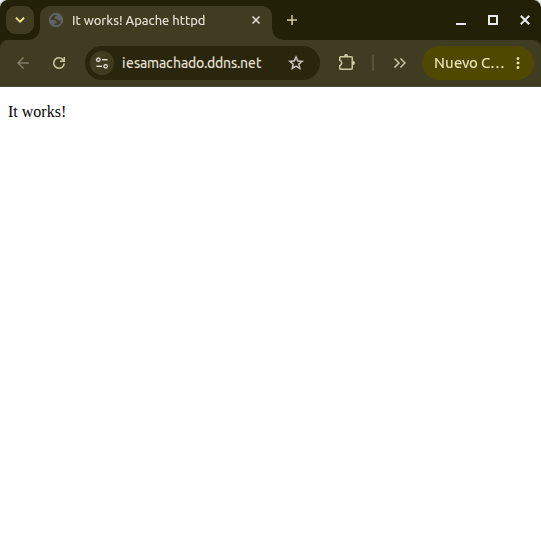

# 🧪 Práctica: Despliegue de Apache en Docker con HTTPS mediante Apache como proxy inverso en AWS

## 🎯 Objetivos
- Desplegar un servidor web en una instancia EC2 de AWS usando Docker.
- Configurar un **proxy inverso con Apache HTTP Server (`httpd`)** en el anfitrión que gestione HTTPS mediante **Let’s Encrypt**.
- Verificar el acceso seguro al servidor web desde el navegador.

## 📋 Requisitos previos
- Cuenta activa en AWS.
- Conocimientos básicos de Docker y Apache.
- Clave SSH para acceder a instancias EC2.
- Puertos 80 (HTTP) y 443 (HTTPS) abiertos en el grupo de seguridad de AWS.
- Saber cómo registrar un dominio con [noip.com](https://www.noip.com/).

---

## 🛠 Parte 1: Preparación del entorno en AWS

1. Accede a AWS EC2.
2. Lanza una instancia nueva Ubuntu Server con al menos 1 GB de RAM. También puede ser debian. Llama la instancia *Proxy inverso*.
3. Asocia tu clave SSH y configura el grupo de seguridad para permitir tráfico **HTTP (80)** y **HTTPS (443)**.
4. Crea una IP elástica y asóciala con la instancia que acabas de crear.
    1. Si no sabes qué es una ip elástica, es crear una IP que no cambia con los reinicios de AWS. Suena muy bien, pero consume más dinero de nuestro crédito. [Para ver cómo crearla sigue estos pasos](https://docs.google.com/presentation/d/1ahcISuJ6ffhaFGoHWMoR1WznhFO6ZuC_d3e03-zvWIk/edit?usp=sharing).
    1. **TODO**. [Práctica para conectar nuestra instancia de Linux con *Dynamic DNS* de `no-ip.com`](https://gemini.google.com/share/d/1zLgY0AS68MBYogDNt37McQUPGDDF6PEO?usp=sharing).
5. Para comprobar que ha funcionado, podemos habilitar en el `security group` asociado a nuestro contenedor que se permita el tráfico ICMP IPv4 para poder hacer ping a nuestro contenedor.
    
6. Ahora podríamos hacer un ping a nuestra IP elástica y debería contestar nuestro contenedor.
   ```bash
   ping <IP_Pública>
   ```
    
6. Registra tu dominio usando la ip elástica (ver imagen más abajo).
    
7. Ahora podríamos hacer ping a nuestro nombre de dominio en lugar de a la IP elástica.
   ```bash
   ping iesantoniomachado.ddns.net
   ```
    
8. Conéctate por SSH a la instancia:
   ```bash
   ssh -i tu_clave.pem ubuntu@<IP_Pública>
   ```
9. También podríamos hacer lo siguiente para conectarnos: usar nuestro nombre de dominio que acabamos de crear.
   ```bash
   ssh -i tu_clave.pem ubuntu@iesamachado.ddns.net # Si tienes docker en ubuntu
   ssh -i tu_clave.pem admin@iesamachado.ddns.net # Si tienes docker en debian
   ```
    

---

## 🐳 Parte 2: Despliegue de Apache en Docker

1. **Instala Docker**
   ```bash
   sudo apt update;
   sudo apt install docker.io -y;
   sudo systemctl enable docker;
   sudo systemctl start docker;
   sudo usermod -aG docker ubuntu # Si estás en ubuntu
   sudo usermod -aG docker admin # Si estás en debian
   ```
    **Para que se apliquen las órdenes de permisos de grupos, tendrás que desconectarte y conectarte de nuevo**.


2. **Ejecuta el contenedor Apache:**
   ```bash
   sudo docker run -d --name apache -p 8080:80 httpd
   ```
   > Apache se expone en el puerto 8080 localmente. El proxy inverso Apache del anfitrión se encargará de redirigir el tráfico HTTPS hacia él.

---

## 🔐 Parte 3: Configuración del proxy inverso con Apache y Let’s Encrypt

1. **Instala Apache y Certbot en el sistema anfitrión:**
   ```bash
   sudo apt update;
   sudo apt install apache2 -y;
   sudo apt install snapd -y;
   sudo systemctl enable --now snapd.service;
   sudo snap install core;
   sudo snap refresh core;
   sudo snap install --classic certbot;
   sudo ln -s /snap/bin/certbot /usr/bin/certbot;
   ```

2. **Habilita los módulos necesarios para la función de proxy inverso y SSL:**
   ```bash
   sudo a2enmod proxy proxy_http ssl headers rewrite;
   ```

3. **Configura Apache como proxy inverso.** Crea el archivo `/etc/apache2/sites-available/apache_proxy.conf` con propietario `root` y permisos `644` (`-rw-r--r--`):
   ```apache
   <VirtualHost *:80>
       ServerName iesamachado.ddns.net

       ProxyPreserveHost On
       ProxyPass / http://127.0.0.1:8080/
       ProxyPassReverse / http://127.0.0.1:8080/

       RequestHeader set X-Forwarded-Proto "http"
       RequestHeader set X-Forwarded-Port "80"

       ErrorLog ${APACHE_LOG_DIR}/proxy_error.log
       CustomLog ${APACHE_LOG_DIR}/proxy_access.log combined
   </VirtualHost>
   ```

4. **Borra/desactiva la configuración por defecto y activa la nueva configuración:**
   ```bash
   sudo a2dissite 000-default.conf;
   sudo a2ensite apache_proxy.conf;
   sudo apache2ctl configtest;
   sudo systemctl restart apache2;
   ```
   

5. **Solicita el certificado con Certbot para Apache:**
   ```bash
   sudo certbot --apache -d iesamachado.ddns.net
   ```
   > Certbot modificará automáticamente la configuración de Apache añadiendo el bloque HTTPS (`*:443`) y la redirección desde HTTP.
   

---

## 🚀 Parte 4: Verificación

Accede desde el navegador a:
- `http://iesamachado.ddns.net`
- `https://iesamachado.ddns.net`

Verifica que el certificado sea válido y que la conexión esté cifrada.


!!! danger "Contenedor docker Apache y no servidor Apache"
    Fíjate que se está mostrando con el *It works!* el contenido del contenedor docker Apache y no la página de prueba de una instalación de Apache en el sistema operativo.

---

## 📦 Ampliando: Nextcloud

Una vez que hemos hecho esto, fíjate: el proxy inverso es el encargado de gestionar la parte de la seguridad y el contenedor apache ya funciona con http, por lo que no tenemos que tocar esta instancia.

Podemos tener cualquier docker funcionando en el puerto 8080 y voilà, ya estará configurado por HTTPS.

¿Por qué no instalamos algo que tenga más chicha? Por ejemplo: **Nextcloud**, una aplicación web similar a Google Drive de código libre. Vamos allá.

1. **Para y elimina el contenedor Apache:**
   ```bash
   sudo docker stop apache;
   sudo docker rm apache;
   ```

2. **Ejecuta esta orden para tener un contenedor Nextcloud funcionando en el puerto 8080 como tenías antes Apache:**
   ```bash
   sudo docker run -d -p 8080:80 --name nextcloud nextcloud
   ```

3. **Accede desde el navegador a:**
   - `http://iesamachado.ddns.net`
   - `https://iesamachado.ddns.net`

Verifica que el certificado sigue siendo válido y que ahora tenemos un servicio Nextcloud funcionando con SSL.